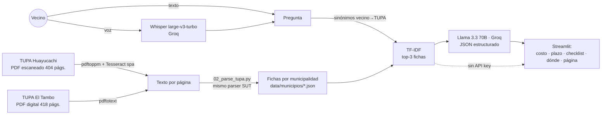

# 🏛️ Wayki — el TUPA de tu municipalidad, explicado como un vecino

> **Hacemos que cualquier vecino sepa qué llevar, cuánto pagar y a dónde ir para su trámite municipal — a la primera — para municipalidades distritales del Perú, mediante OCR de su TUPA escaneado + RAG con un LLM + preguntas por voz con Whisper.**

*Wayki* (*wayqi*, "hermano" en quechua) es un asistente que lee el **TUPA oficial de cada municipalidad** y responde en lenguaje simple, por texto o por voz, citando la página exacta.

- **Piloto: Municipalidad Distrital de Huayucachi** (Huancayo, Junín). Su TUPA es un PDF **escaneado de 404 páginas** colgado en un Google Drive → OCR → 23 procedimientos.
- **Segunda municipalidad: El Tambo** (Huancayo). TUPA 2021 digital de 418 páginas → **178 procedimientos**, procesados con el **mismo parser sin cambiar una línea**. Así se ve la escalabilidad.

| | |
|---|---|
| **Demo** | **[https://qthbrgdhnhjyhp7pywtvgz.streamlit.app/](https://qthbrgdhnhjyhp7pywtvgz.streamlit.app/)** (o `streamlit run app.py`) |
| **Datos** | TUPA Huayucachi, [Ordenanza Municipal N° 005-2022-CM/MDCHI](https://drive.google.com/file/d/1oYUDl-Vtx1KLbppotWYfYg5IYguCytQE/view) ([Portal de Transparencia](https://www.transparencia.gob.pe/enlaces/pte_transparencia_enlaces.aspx?id_entidad=11095&id_tema=5)) · TUPA 2021 El Tambo ([Portal de Transparencia](https://www.transparencia.gob.pe/enlaces/pte_transparencia_enlaces.aspx?id_entidad=11090&id_tema=5)) |
| **Herramientas del curso** | LLM + RAG + structured outputs (sesión 08) · Whisper (sesión 13) · *bonus:* Document AI / OCR (sesión 10) |

---

## 1. One-liner

**Hacemos** que los vecinos resuelvan su trámite municipal a la primera visita **para** municipalidades distritales del Perú (piloto en Huayucachi, ya funcionando también en El Tambo) **mediante** OCR de su TUPA escaneado, búsqueda semántica + LLM que responde en JSON verificable, y preguntas por voz con Whisper.

## 2. Founder

**Alvaro Rubén Carhuamaca Remigio** — Licenciado en Gestión Pública (PUCP), diplomando en Ciencia de Datos (Q-Lab PUCP).

- Conozco el problema desde adentro: apoyo a la nueva gestión de la **Municipalidad Distrital de Huayucachi** en la transferencia de gestión (ROF, organigrama, cargos).
- Hice un proyecto de **gestión por procesos para OEFA**: sé leer un TUPA, un ROF y un mapa de procesos, y sé dónde se rompen.
- Construí antes un **servidor MCP sobre Consulta Amigable del MEF** y un agente socioeconómico con BCRP + ENAHO en este curso: sé llevar datos públicos peruanos a herramientas de IA.

## 3. Problema

**Quién lo sufre:** el vecino que quiere abrir una bodega, renovar su certificado de Defensa Civil (ITSE) o pedir información pública; y el personal de mesa de partes, que responde las mismas preguntas todo el día.

**Qué cuesta:** el TUPA *existe* y es obligatorio publicarlo, pero en Huayucachi es un **PDF escaneado de 404 páginas** (sin texto buscable) dentro de un Google Drive. En la práctica el vecino se informa yendo a la municipalidad. Si le falta un requisito, regresa: otro pasaje, otra mañana sin trabajar. Ejemplo real del TUPA: una licencia para riesgo **muy alto** cuesta **S/ 998.20** y la de **riesgo bajo S/ 105.50**; la licencia provisional para **bodegas es gratuita** — pero eso está en las págs. 27, 50 y 86 de un escaneo.

**Cómo se resuelve hoy:** preguntando en ventanilla, por teléfono (964 563 526, según el TUPA) o a un tramitador.

**No es solo Huayucachi.** En el Portal de Transparencia, el enlace al TUPA de la vecina Municipalidad de **Chilca** dice "TUPA 2014" y apunta a la web genérica del PSCE, no a un documento. El de **El Tambo** está en un servidor con IP pública (`192.141.99.36:8081`). La información es obligatoria y pública, pero en la práctica no se puede usar.

**Evidencia — 3 conversaciones con usuarios potenciales** (llamadas del 9/11/2026, notas en [`docs/research/`](docs/research/)):

| Quién | Lo que dijo | Qué implica para Wayki |
|---|---|---|
| [Ciudadano, 38 años, independiente](docs/research/conversacion_1.md) | Fue **3 veces** por una licencia de funcionamiento; en internet no encontró información clara; dejó de trabajar para consultar. | El dolor es real y cuesta tiempo e ingresos. Lo usaría **si la información es oficial** → citar la página del TUPA. |
| [Mesa de partes, 4 años de experiencia](docs/research/conversacion_2.md) | **6–7 de cada 10 consultas** son sobre requisitos, costos u oficina; muchos vienen solo a pedir orientación. | Hay una carga operativa que Wayki puede absorber. Condición: **respuestas actualizadas** y consistentes con la muni. |
| [Encargado de modernización](docs/research/conversacion_3.md) | Compraría si demuestra información correcta, menos consultas repetitivas, poca carga para el personal y **costo razonable**; pregunta quién actualiza la información. | Valida el modelo B2G. El servicio debe incluir la actualización del TUPA y métricas de uso. |

## 4. Solución e insight

1. **OCR** de las 404 páginas (o `pdftotext` si el PDF es digital) → texto por página ([`data/huayucachi_paginas/`](data/huayucachi_paginas/), [`data/el-tambo_paginas/`](data/el-tambo_paginas/)).
2. **Parser** que detecta cada ficha SUT ("Denominación del Procedimiento…") y extrae código, requisitos, costo, plazo, calificación y oficina → [`data/municipios/`](data/municipios/) (Huayucachi: 23 procedimientos; El Tambo: 178).
3. **Recuperación** TF-IDF con un diccionario de *palabras de vecino → palabras del TUPA* ("defensa civil" → "inspección técnica de seguridad en edificaciones", "cerrar mi negocio" → "cese de actividades").
4. **LLM** que responde **solo** con los fragmentos recuperados y devuelve **JSON estructurado** (requisitos, costo, plazo, dónde, consejo, página). La app lo pinta como checklist.
5. **Voz:** el vecino graba su pregunta y **Whisper** la transcribe.
6. **Sin API key** la app sigue funcionando: muestra la ficha extraída del TUPA ("modo sin IA").

**Insight:** el problema no es que falte información pública — es que **está en un formato que nadie puede leer**. Los TUPA siguen un formato estándar (SUT, de la PCM), así que el mismo pipeline sirve para cualquiera de las ~1,890 municipalidades del país. Y el vecino no pregunta "Inspección Técnica de Seguridad en Edificaciones posterior…": pregunta "¿cuánto es lo de Defensa Civil para mi tiendita?".

## 5. ¿Por qué ahora?

- **Voz en español andino, barata:** Whisper transcribe español con acentos regionales por centavos; hace 3 años no había STT abierto de esta calidad.
- **LLMs con salida estructurada:** hoy un modelo abierto (Llama 3.3 70B) devuelve JSON fiable y rápido; la respuesta se puede verificar campo por campo contra la página del TUPA.
- **Costo por consulta < 1 céntimo de sol**, lo que hace viable venderle a una municipalidad pequeña.
- **TUPA estandarizados (SUT/PCM):** los procedimientos estandarizados obligan a todas las municipalidades al mismo formato → un parser escala a todo el país.

## 6. Demo

**URL:** [https://qthbrgdhnhjyhp7pywtvgz.streamlit.app/](https://qthbrgdhnhjyhp7pywtvgz.streamlit.app/)

**Correr en local:**
```bash
git clone https://github.com/alvarorubencarhuamaca/wayki.git
cd wayki
pip install -r requirements.txt
# opcional (voz + IA): crea .streamlit/secrets.toml con GROQ_API_KEY = "gsk_..."
streamlit run app.py
```

**Reproducir los datos desde el PDF** (necesita `tesseract-ocr` con `spa` y `poppler-utils`):
```bash
bash pipeline/01_ocr.sh "TUPA 2023.pdf" data/huayucachi_paginas 1 104   # PDF escaneado
python pipeline/02_parse_tupa.py huayucachi
python pipeline/02_parse_tupa.py el-tambo                               # PDF digital (pdftotext)
```

**Agregar una municipalidad nueva** (≈ 20 minutos):
1. Descargar su TUPA del Portal de Transparencia.
2. Texto por página: `bash pipeline/01_ocr.sh tupa.pdf data/<slug>_paginas` si es escaneado, o `pdftotext -f N -l N` si es digital.
3. Añadir su entrada en [`data/municipios.json`](data/municipios.json) (nombre, fuente, rango de páginas).
4. `python pipeline/02_parse_tupa.py <slug>`. Aparece sola en el selector de la app.

**Capturas**

| Pregunta | Respuesta con checklist | Voz |
|---|---|---|
|  |  |  |

**Arquitectura**



**Modelos y por qué**

| Componente | Modelo / herramienta | Por qué |
|---|---|---|
| OCR | Tesseract 5 (`spa`) | Corre en CPU; el escaneo es limpio (formato SUT), no hizo falta un modelo más pesado como PaddleOCR. |
| Búsqueda | TF-IDF (scikit-learn) + sinónimos, un índice por municipalidad | 23–178 documentos por municipio: no hacen falta embeddings ni base vectorial; es explicable y gratis. Con más municipios, el siguiente paso son embeddings. |
| Respuesta | `llama-3.3-70b-versatile` vía Groq (con *fallback* automático a otros modelos) | Modelo abierto, rápido, tier gratuito, buen español, `response_format: json_object`. |
| Voz | `whisper-large-v3-turbo` vía Groq | Whisper (sesión 13) sin GPU propia; la misma API key sirve para todo. |

## 7. Modelo de negocio

- **Quién paga:** la **municipalidad** (B2G). El vecino usa Wayki gratis. Argumento de compra: menos colas y consultas repetidas en mesa de partes, mejor cumplimiento de transparencia, y un canal más para el vecino.
- **Precio:** **S/ 290 al mes por municipalidad distrital** (incluye digitalizar su TUPA y actualizarlo cuando cambie). Implementación inicial: S/ 900 una vez.
- **Huayucachi:** piloto **gratuito** (para validar y evitar cualquier conflicto de interés). Los clientes que pagan son otras municipalidades.
- **Escalabilidad:** todas las municipalidades están obligadas a tener TUPA, y los procedimientos estandarizados (licencia de funcionamiento, ITSE, acceso a la información) son iguales en todas. Agregar El Tambo no requirió cambiar código. Primer mercado: los 28 distritos de la provincia de Huancayo; luego Junín; luego el país (~1,890 municipalidades).
- **Costo por usuario** (estimado con precios publicados en [groq.com/pricing](https://groq.com/pricing), verificar):
  - Consulta de texto ≈ 3,000 tokens de entrada + 400 de salida → ≈ **US$ 0.002** (≈ S/ 0.008).
  - Consulta por voz: + ~15 s de Whisper turbo → ≈ US$ 0.0002 adicional.
  - **1,000 consultas al mes ≈ US$ 2.2 (≈ S/ 8)** frente a S/ 290 de ingreso → margen bruto > 95 %.
  - Servidor: Streamlit Community Cloud (S/ 0) en el piloto; luego un VPS de ~US$ 6/mes.
  - OCR de un TUPA nuevo: CPU, ~15 min por 400 páginas → costo casi nulo.

## 8. Herramientas del curso

| Herramienta (sesión) | Dónde | Para qué |
|---|---|---|
| **LLM con structured outputs + RAG (08)** | [`wayki/core.py`](wayki/core.py) → `BuscadorTUPA`, `responder()` | Recupera las fichas del TUPA y genera la respuesta en JSON verificable. |
| **Whisper speech-to-text (13)** | [`wayki/core.py`](wayki/core.py) → `transcribir()`; [`app.py`](app.py) pestaña 🎙️ | El vecino pregunta hablando. |
| *Bonus:* Document AI / OCR (10) | [`pipeline/01_ocr.sh`](pipeline/01_ocr.sh), [`pipeline/02_parse_tupa.py`](pipeline/02_parse_tupa.py) | Convertir el PDF escaneado en datos. |
| Claude Code / Claude (16) | todo el repo | Agente de desarrollo (ver sección 9). |

## 9. Qué hizo el agente

Usé **Claude (Cowork)** como agente de desarrollo. Generó:
- El pipeline de OCR y el parser de fichas SUT, incluida la tabla de correcciones manuales (`CORRECCIONES`).
- `wayki/core.py` (búsqueda, prompt, llamada al LLM con JSON y a Whisper) y `app.py` (interfaz Streamlit).
- El primer borrador de este README.
- También encontró el TUPA real: no estaba en gob.pe, sino en un Google Drive enlazado desde el Portal de Transparencia.

Lo que hice yo: elegir el problema, hablar con los usuarios, verificar montos y plazos contra el PDF, configurar el despliegue y la key, y decidir el modelo de negocio. Entiendo y puedo modificar cada archivo.

---

### Limitaciones y siguiente paso

- **Huayucachi:** indexa los 23 procedimientos del TUPA 2023 (licencias de funcionamiento, ITSE, espectáculos, acceso a la información). El TUPA base de 2020 (Ordenanza 004-2020-CM/MDCHI: registro civil, obras, etc.) no está publicado en línea → **siguiente paso: pedirlo a la municipalidad y pasarlo por el mismo pipeline.**
- **El Tambo:** es el TUPA 2021 publicado en el portal. Si hay una versión más reciente, se reemplaza el PDF y se corre el pipeline otra vez.
- **Formatos:** el parser espera fichas en formato SUT. Los TUPA antiguos en tablas necesitarán un parser adicional (o que el LLM lea el texto crudo).
- El OCR puede leer mal algún monto: cada respuesta cita la página para verificarla. Wayki **orienta**; no reemplaza la atención oficial.
- Roadmap: canal de WhatsApp, respuesta en audio (TTS), quechua, y un panel para que la municipalidad vea qué preguntan los vecinos.

### Licencia
MIT. Los datos del TUPA son información pública de la Municipalidad Distrital de Huayucachi.
